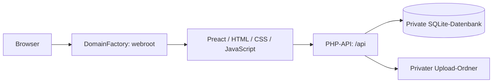
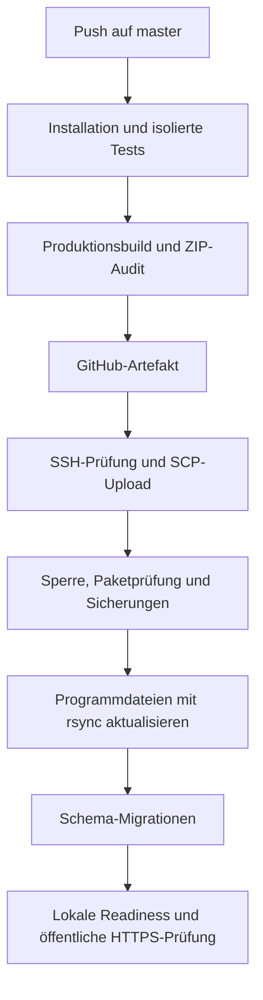

# freiberger.design – technische Übersicht und Deployment

Stand: 3. November 2026

Technischer Ausgangsstand: Commit `f381e44`

Repository: https://github.com/wfreibe/cms_freibe

Produktive Webseite: https://freiberger.design

CMS: https://freiberger.design/cms

Diese Dokumentation beschreibt die im Quellcode eingerichtete Architektur und den am 2. November 2026 erfolgreich ausgeführten GitHub-Deployment-Prozess. Passwörter und private Schlüssel sind nicht Bestandteil dieser Datei.

## 1. Anwendung und technische Basis

Die Anwendung verbindet eine öffentliche Portfolio-Webseite mit einem eigenen CMS. Grundlage ist das Framework von cms_sfreibe, angepasst an die Bilder, Inhalte und Gestaltung von freiberger.design.

| Bereich | Technik und Aufgabe |
|---|---|
| Frontend | Preact; öffentliche Webseite und CMS als Browseranwendung |
| Build und lokale Entwicklung | Vite; erzeugt produktive JavaScript- und CSS-Dateien |
| Backend | PHP; JSON-API mit PDO |
| Datenbank | SQLite; Inhalte, Verwaltungsdaten und Administratorzugang |
| HTML-Bereinigung | DOMPurify im Browser, HTMLPurifier im Backend |
| Bilder | PHP GD zur Prüfung und Neukodierung hochgeladener Bilder |
| Hosting | DomainFactory; statische Dateien und PHP-API |
| Automatisierung | GitHub Actions, SSH, SCP und rsync |
| CI-Laufzeit | Ubuntu 24.04, Node.js 22 und PHP 8.3 |
| Server-CLI | Explizit `/usr/bin/php83`; zuletzt als PHP 8.3.36 geprüft |

Der generische Serverbefehl `php` zeigte bei der Einrichtung PHP 7.4.33. Deshalb verwendet das Deployment ausdrücklich `/usr/bin/php83`. Die PHP-Version für HTTP-Aufrufe wird separat im Hosting konfiguriert.

Node.js wird zum Entwickeln, Testen und Bauen benötigt. Die produktive Webseite benötigt keinen laufenden Node- oder Vite-Prozess.

## 2. Architektur und Aufruf einer Seite



1. Apache liefert die fertige Browseranwendung aus `webroot/`.
2. Die Anwendung erkennt die aufgerufene Seitenadresse.
3. Inhalte werden über die PHP-API geladen.
4. Das Frontend stellt Texte, Bilder und Slideshows dar.
5. CMS-Änderungen werden nach Anmeldung über dieselbe API gespeichert.

Die Apache-Regeln leiten API-Anfragen an `api/api.php` weiter. Öffentliche Seitenadressen wie `/aboutme` oder `/project/L1_p` erhalten die Browseranwendung, sofern keine passende Datei oder kein Verzeichnis existiert.

### Zentrale Dateien im Quellcode

| Datei oder Verzeichnis | Aufgabe |
|---|---|
| `frontend/src/app.jsx` | Auswahl zwischen öffentlicher Webseite und CMS |
| `frontend/src/components/PublicWebsite.jsx` | Öffentliche Darstellung |
| `frontend/src/components/CMSDashboard.jsx` | CMS-Anmeldung und Verwaltungsanbindung |
| `frontend/src/components/CMSWorkspace.jsx` | CMS-Arbeitsoberfläche und Seitenauswahl |
| `frontend/src/components/AdminModal.jsx` | Bearbeitungsdialog für Seiteninhalte |
| `frontend/src/components/RichTextEditor.jsx` | Formatierter Texteditor |
| `frontend/src/components/SlideshowEditor.jsx` | Bearbeitung der Slideshows |
| `frontend/src/components/SectionImageUpload.jsx` | Upload für Seiten- und Hintergrundbilder |
| `frontend/src/components/PageImageLayout.jsx` | Gemeinsame Bildanordnung für Vorschau und Webseite |
| `frontend/src/page-routes.json` | Zuordnung bestehender URLs zu CMS-Seiten |
| `frontend/public/api/api.php` | Zentraler HTTP-API-Einstieg |
| `lib/` | PHP-Funktionen für Datenbank, Anmeldung, Validierung und Uploads |
| `migrations/` | Versionierte SQL-Änderungen der Datenbankstruktur |
| `seeds/design-pages.json` | Öffentliche Ausgangsinhalte für einen bewussten Neuaufbau |
| `.github/workflows/deploy.yml` | GitHub-Tests, Build und Produktionsdeployment |

## 3. Öffentliche Webseite und CMS

Die bisherigen elf Seitenadressen umfassen Startseite, Person, Kontakt, sechs Projekte, Impressum und Datenschutzerklärung. Die öffentliche Leistungsbeschreibung beschränkt Architektur auf LP 1–4.

Das CMS unterstützt insbesondere:

- Bearbeitung von Seiteninhalten, Überschriften und Akkordeons;
- Veröffentlichung und Sichtbarkeit in der Navigation;
- formatierten Text mit Überschriften, Fett/Kursiv, Listen und Links;
- HTML-Quelltextansicht und Inhaltsvorschau;
- Slideshow-Bilder, Titel und Bildunterschriften;
- Sortierung der Slides per Ziehen sowie über Schaltflächen;
- Vorschau der Slideshow vor dem Speichern;
- Upload, Austausch und Entfernen der Zuordnung von Seiten- und Hintergrundbildern;
- Seitenbilder im Originalformat, als 16:9-Ausschnitt oder neben dem Text links/rechts.

Auf kleinen Bildschirmen stehen Seitenbild und Text untereinander. Die Slideshows verwenden einen weichen Bildwechsel ohne Zoom-Effekt.

### Upload-Verarbeitung

Hochgeladene Bilder müssen JPEG, PNG oder WebP sein. Die Anwendung begrenzt ein Bild auf 8 MiB und 12 Millionen Pixel.

Das Backend prüft die Datei, dekodiert sie mit GD und kodiert sie neu. Die gespeicherte Datei erhält einen zufälligen Namen. Die Auslieferung erfolgt über `/api/media/ID`.

Uploads werden sofort gespeichert. Die Zuordnung zu einer Seite wird erst beim Speichern des Inhalts übernommen. Entfernen einer Bildzuordnung oder Abbrechen des Editors löscht die bereits hochgeladene Datei nicht automatisch.

## 4. Datenhaltung und Trennung von Code und Inhalten

| Daten | Speicherort in Produktion | Bestandteil des normalen Code-Deployments? |
|---|---|---|
| Programmcode, Styles und ursprüngliche statische Medien | `webroot/` und private Serverbibliotheken | Ja |
| CMS-Seiten und Akkordeons | `server/data/content.sqlite` | Nein |
| Administrator und Passwort-Hash | SQLite-Datenbank | Nein |
| CMS-Bilddateien | `server/data/uploads/` | Nein |
| Sitzungsdateien | `server/data/sessions/` | Nein |
| Aktive Hostingkonfiguration | `server/config/cms_config.php` | Nein |
| Vorhandene Datenbanksicherungen | `server/backups/` | Nein |

Wichtige Datenbanktabellen sind `sections`, `section_accordions`, `schema_migrations`, `admin_credentials` und `login_attempts`.

Die Migrationen sind fortlaufend nummeriert. Migration 010 ergänzt beispielsweise die gespeicherte Bildanordnung `image_layout`.

**Lokale und produktive CMS-Inhalte werden nicht automatisch synchronisiert.** Ein Git-Push überträgt keine lokale Inhaltsdatenbank.

Die Seed-Datei enthält Ausgangsinhalte. Sie ist kein Export des jeweils aktuellen produktiven CMS.

## 5. Anmeldung, Cookies und Zugriffsschutz

Die öffentliche Anwendung startet bei normalen Inhaltsabrufen keine CMS-Sitzung und verwendet keine lokale Sprachspeicherung im Browser.

Für den CMS-Zugang wird ein Session-Cookie mit folgenden Eigenschaften verwendet:

- Name: `FREIBERGER_DESIGN_SESSION`;
- Pfad: `/api`;
- `HttpOnly` und `SameSite=Strict`;
- in Produktion `Secure`, also Übertragung über HTTPS.

Administrationsschreibzugriffe benötigen Anmeldung und einen CSRF-Token. Loginversuche werden begrenzt. Der Administrator wird über einen getrennten CLI-Prozess angelegt; normale Migrationen oder Deployments erzeugen keinen neuen Zugang.

Die Anwendung besitzt kein aktives Kontaktformular zum Versand von Nachrichten. Die Kontaktangaben sind Teil der Webseiteninhalte.

## 6. Verzeichnisstruktur auf dem Server

Basisverzeichnis:

```text
/kunden/272116_83558/webseiten/cms_freibe/
├── webroot/                      ← Zielverzeichnis der Domain
│   ├── index.html
│   ├── .htaccess
│   ├── assets/
│   ├── media/
│   └── api/
├── server/                       ← außerhalb des öffentlichen Webroots
│   ├── lib/
│   ├── bin/
│   ├── migrations/
│   ├── seeds/
│   ├── vendor/
│   ├── docs/
│   ├── config/
│   │   └── cms_config.php
│   ├── data/
│   │   ├── content.sqlite
│   │   ├── sessions/
│   │   └── uploads/              ← wenn CMS-Uploads vorhanden sind
│   └── backups/
└── .deploy/
    ├── .htaccess                 ← zusätzlicher HTTP-Zugriffsschutz
    ├── deploy.lock
    ├── packages/
    ├── releases/
    └── history/
```

Die Domain zeigt auf:

```text
/webseiten/cms_freibe/webroot
```

Dieser relative Hostingpfad entspricht dem vollständigen Pfad unter `/kunden/272116_83558/`.

## 7. Branches und Freigabeprozess

GitHub enthält die beiden Branches `development` und `master`. Der Remote-Stand wurde am 3. November 2026 geprüft.

| Ereignis | Wirkung |
|---|---|
| Push auf `development` | Tests, Build und Deployment-Artefakt |
| Push auf `master` | Tests, Build und bei Erfolg Produktionsdeployment |
| Pull Request nach `master` oder `development` | Tests und Build, kein Produktionsdeployment |
| Manueller Workflow-Start auf `master` | Tests, Build und Produktionsdeployment |

Der vorgesehene Arbeitsablauf ist:

~~~text
Änderung in development
        ↓
Push: automatische Tests und Build
        ↓
Pull Request development → master
        ↓
Prüfung und Merge
        ↓
Automatisches Produktionsdeployment
~~~

Die Abnahme erfolgt im Pull Request oder in einer später separat eingerichteten Testumgebung. Für development besteht aktuell keine eigene gehostete Webseite; es verwendet für die Tests eine isolierte Datenbank.

Die Workflow-Filter enthalten nur `development` und `master`. Änderungen am Workflow werden mit dem jeweiligen Commit und Push im betreffenden Branch wirksam.

## 8. Automatisches Deployment im Detail



### Phase A: Prüfen und Bauen auf GitHub

Der Job `verify` läuft auf Ubuntu 24.04 mit Node.js 22 und PHP 8.3.

1. Repository auschecken.
2. Abhängigkeiten aus den Lockdateien installieren:
   `npm ci`, `npm --prefix frontend ci` und `composer install --no-dev`.
3. Temporäre CI-Konfiguration und eine eigene SQLite-Datenbank anlegen.
4. Migrationen und den Import der Ausgangsinhalte ausschließlich in dieser Testdatenbank ausführen.
5. Lokalen Entwicklungsserver für die Integrationstests starten.
6. CMS-, Routing-, Sicherheits-, Upload- und Texteditor-Tests ausführen.
7. ZIP-Validierung und Shell-Syntax der Deployment-Skripte prüfen.
8. Mit `npm run package:deploy` das Frontend frisch bauen und das Deployment-Paket auditieren.

Das Ergebnis heißt `dist-packages/cms_sfreibe-deploy.zip`. Der Dateiname ist vom ursprünglichen Framework übernommen.

GitHub speichert es als Artefakt `deployment-COMMIT_SHA` mit 14 Tagen Aufbewahrung. Das Paket enthält keine aktive Konfiguration, Inhaltsdatenbank, CMS-Uploads, Sitzungen oder privaten Schlüssel.

### Phase B: Zugriff auf Produktion

Der Job `production` startet nur nach erfolgreichem `verify` auf `master`, nicht bei Pull Requests.

Er verwendet die GitHub-Umgebung `production`. Diese ist auf den Branch master beschränkt.

| Einstellung | Bedeutung |
|---|---|
| Secret `DEPLOY_SSH_KEY` | Eigener privater Deployment-Schlüssel |
| Secret `DEPLOY_KNOWN_HOSTS` | Bereits geprüfter Hostschlüssel |
| Variable `DEPLOY_HOST` | `freiberger-net.de` |
| Variable `DEPLOY_USER` | SSH-Konto für das Deployment |
| Variable `DEPLOY_PATH` | Vollständiges Basisverzeichnis der Anwendung |
| Variable `DEPLOY_PHP` | `/usr/bin/php83` |

Der öffentliche Deployment-Schlüssel ist im SSH-Konto auf dem Server hinterlegt. Der private Schlüssel wird nur im temporären GitHub-Runner verwendet.

Die Verbindung verwendet Hostschlüsselprüfung und `MACs=hmac-sha2-256-etm@openssh.com`. Diese Option funktioniert sowohl für SSH als auch für SCP. Ein unbekannter Hostschlüssel wird nicht automatisch akzeptiert.

### Phase C: Paketübertragung und Sicherung

`scripts/deploy.sh` prüft die Variablen und die vorhandene Installation. Eine bestehende produktive Datenbank ist Voraussetzung.

Die Release-ID besteht aus:

```text
COMMIT_SHA-GITHUB_RUN_ID-RUN_ATTEMPT
```

Das ZIP wird nach `.deploy/packages/RELEASE.zip` hochgeladen.

`scripts/deploy_remote.sh` führt danach auf dem Server aus:

1. Zielpfad und erforderliche Werkzeuge prüfen.
2. Deployment-Sperre mit `flock` erwerben.
3. SHA-256-Prüfsumme des ZIP vergleichen.
4. Neue, noch nicht vorhandene Release- und Sicherungsverzeichnisse anlegen.
5. ZIP-Einträge auf erlaubte Pfade, Pfadausbruch, doppelte Einträge, Symlinks und unerlaubte private Dateien prüfen.
6. Paket nach `.deploy/releases/RELEASE/` entpacken.
7. Aktive Konfiguration, vorhandene Datenbank und sichere Cookie-Einstellung prüfen.
8. Verifizierte SQLite-Sicherung über die vorhandene Backup-CLI erstellen.
9. Vorhandene Uploads als `uploads.tar` sichern.
10. Bisherige Programmdateien als `application.tar` sichern.

Die Datenbanksicherung liegt unter `server/backups/`. Ihre Zuordnung zum Lauf steht in `.deploy/history/RELEASE/database-backup.txt`.

### Phase D: Programmdateien aktualisieren

Rsync aktualisiert die Dateien aus dem entpackten Paket. Dabei werden einzelne Dateien verzögert eingesetzt und ersetzte Dateien zusätzlich unter `replaced-files/` gesichert.

Folgende Ziele sind vom Abgleich ausgeschlossen:

```text
/server/data/
/server/backups/
/server/config/cms_config.php
```

Es wird kein `--delete` verwendet. Zusätzliche oder ältere Dateien bleiben bestehen. Der Prozess führt auch keine automatische Bereinigung alter Pakete oder Backups aus.

`.deploy/releases/` ist ein entpackter Bereitstellungsstand. Die Webseite wird weiterhin aus dem festen `webroot/` bedient; es gibt aktuell keinen atomaren Symlink-Wechsel zwischen Releases.

### Phase E: Migrationen und Erfolgskontrolle

Nach dem Kopieren werden mit `/usr/bin/php83` die ausstehenden Schema-Migrationen ausgeführt. Es erfolgen kein Seed-Import und keine Administrator-Provisionierung.

Danach folgen:

1. lokale Readiness-Prüfung der Installation;
2. Schreiben des Markers `history/RELEASE/complete` nach erfolgreicher serverseitiger Prüfung;
3. öffentlicher HTTPS-Abruf von `/api/ready`, erwartet wird `{"ready":true}`;
4. Kontrolle, dass die öffentliche Startseite auf die JavaScript-Datei aus dem gebauten Paket verweist.

Der Marker `complete` bestätigt die serverseitigen Schritte. Erst der erfolgreiche gesamte GitHub-Job bestätigt zusätzlich die öffentliche HTTPS-Prüfung.

## 9. Tagesgeschäft: Welche Änderung braucht ein Deployment?

| Änderung | Vorgehen |
|---|---|
| Produktiven Seitentext im CMS ändern | Im produktiven CMS speichern; kein Code-Deployment |
| Produktives Bild hochladen oder Slideshow sortieren | Im produktiven CMS bearbeiten und speichern |
| Layout, Farben oder Funktionen im Quellcode ändern | Entwickeln, testen und nach master übernehmen |
| Lokalen CMS-Inhalt ändern | Bleibt lokal; wird nicht durch Git-Push veröffentlicht |
| Datenbankstruktur ändern | Geprüfte Migration hinzufügen; Deployment führt sie aus |
| Aktive Serverkonfiguration ändern | Gezielte private Änderung; wird vom Deployment erhalten |

Ein Deployment ist keine laufende Inhalts- oder Bildsynchronisation zwischen dem lokalen Rechner und dem Server.

## 10. Kontrolle, Fehler und Wiederherstellung

Läufe und einzelne Schritte sind unter https://github.com/wfreibe/cms_freibe/actions sichtbar.

| Fehlerphase | Auswirkung |
|---|---|
| Tests oder Build fehlschlagen | Kein Produktionsdeployment |
| SSH-Prüfung oder Upload fehlschlagen | Programmdateien noch nicht aktualisiert |
| Paketprüfung oder Sicherung fehlschlagen | Programmdateien noch nicht aktualisiert |
| Kopieren, Migration oder Readiness fehlschlagen | Teilweise aktualisierter Programmstand möglich |
| Öffentliche HTTPS-Prüfung fehlschlägt | Serverupdate kann bereits abgeschlossen sein; Lauf bleibt fehlgeschlagen |

Das Update erfolgt dateiweise und ist kein atomarer Austausch der gesamten Anwendung. Währenddessen können kurzzeitig unterschiedliche Programmstände zusammentreffen.

Ein erneuter Workflow-Lauf bekommt durch die Versuchszahl eine andere Release-ID. Vor einem erneuten Start nach einem Fehler müssen dessen Phase und eventuelle Datenbankänderungen geprüft werden.

Es gibt keinen automatischen Datenbank-Rollback. Dieser könnte nach dem Deployment entstandene CMS-Änderungen verlieren. Eine Wiederherstellung muss Programmversion, Datenbankschema und erforderlichenfalls Datenbank und Uploads gemeinsam berücksichtigen.

Vorhandene Dateien, alte Backups und Releases werden nicht automatisch gelöscht. Für den langfristigen Betrieb ist eine bewusst festgelegte Aufbewahrung sinnvoll; aktuell ist keine automatische Bereinigung konfiguriert.

### Nachgewiesener erster erfolgreicher Produktionslauf

Am 2. November 2026 wurde der Ablauf erfolgreich ausgeführt:

https://github.com/wfreibe/cms_freibe/actions/runs/41530144831

Danach wurden öffentliche Seiten und die API geprüft. Die elf CMS-Seiten und Akkordeons entsprachen der unmittelbar zuvor erstellten Datenbanksicherung; die Konfiguration und der Upload-Bestand waren unverändert.

Diese Aussage beschreibt die damalige Prüfung, keine erneute Live-Prüfung vom 3. November 2026.

## 11. Lokale Befehle und ergänzende Dokumente

Lokales Projekt: `C:\Dev\freiberger_design`

```text
npm run dev            Lokale Webseite :3011 und PHP-API :8011
npm test               Projektbezogene Tests
npm run build          Frontend bauen und prüfen
npm run package:deploy Hosting-Paket frisch bauen und auditieren
npm run package:source Quellcodepaket erstellen
php bin/backup.php     SQLite-Sicherung; Uploads separat sichern
php bin/backup.php --check  Datenbankintegrität prüfen
php bin/migrate.php    Ausstehende Datenbankmigrationen ausführen
```

Die CLI-Befehle müssen im richtigen Projekt und mit der richtigen Konfiguration ausgeführt werden. In Produktion ist der ausdrücklich geprüfte PHP-Befehl zu verwenden.

Weiterführende Projektdateien:

- `README.md`: lokale Einrichtung und CMS-Funktionen;
- `docs/DEPLOYMENT.md`: manuelles Erstdeployment;
- `docs/GITHUB_DEPLOYMENT.md`: GitHub-Automatisierung;
- `.github/workflows/deploy.yml`: tatsächliche Workflow-Definition;
- `scripts/deploy.sh`: Verbindung und öffentliche Prüfung;
- `scripts/deploy_remote.sh`: Sicherung, Übertragung und Migration auf dem Server.

## Weiterentwicklung vom 5. November 2026

Der modulare Baustein-Editor, eigene URL-Namen, Menüzuordnung, Symbolaktionen und Hintergrundkontraste ergänzen die bisherige CMS-Architektur. Typen, Bedienung, Erhalt der Bestandsinhalte und Migrationen 011–013 sind in [INHALTSBAUSTEINE.md](INHALTSBAUSTEINE.md) dokumentiert. Die oben beschriebenen Produktionsprüfungen vom 2. November beziehen sich auf den damaligen Stand.
